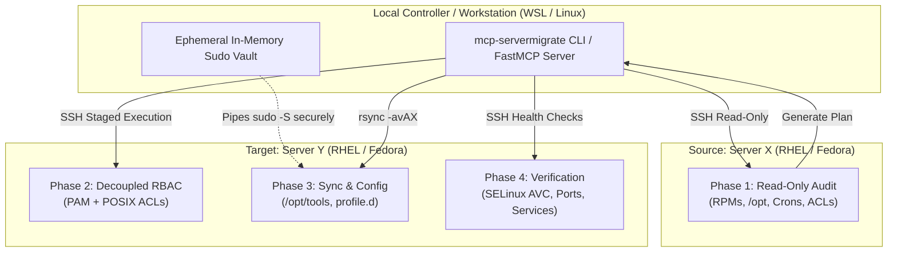

# 🚀 MCP ServerMigrate Agent

[](https://www.python.org/downloads/)
[](https://www.redhat.com/en/technologies/linux-platforms/enterprise-linux)
[](https://modelcontextprotocol.io/)
[](LICENSE)

An intelligent, enterprise-grade **Model Context Protocol (MCP)** agent and CLI designed for migrating and modernizing **RHEL & Fedora** servers.

Built specifically for **domain-joined, policy-managed environments** (SSSD, Active Directory, Red Hat Satellite, GPO baselines), `mcp-servermigrate` bridges the gap between central compliance and application-level customizations.

---

## 🌟 Key Features

* 🔍 **Phase 1: Deep Discovery & Gap Analysis**
  * Differentiates OS/Satellite-managed RPMs from unmanaged flat binaries and standalone tools (`gh`, `rclone`, custom binaries in `/opt` and `/usr/local/bin`).
  * Discovers running systemd services, active listening sockets (`ss`), and custom root crontabs without picking up baseline noise.
* 🛡️ **Phase 2: Decoupled RBAC & Shell Layering**
  * Bridges Active Directory identities to local semantic role groups (`tool_users`, `app_operators`) via PAM (`/etc/security/group.conf`).
  * Applies **POSIX ACLs with default inheritance (`-d`)** so new binaries automatically inherit least-privilege permissions.
  * Deploys system-wide non-destructive shell standards in `/etc/profile.d/` while preserving full user customization in `~/.bashrc`.
* 🔐 **Phase 3: Safe Staged Execution with Ephemeral Credentials**
  * Rotating sudo passwords live strictly in **volatile memory**—never leaked into LLM contexts, logs, or disk.
  * Interactive human-in-the-loop approval gates before any elevated mutation (with optional `--auto-approve-sudo` bypass).
  * True enterprise sync preserving extended attributes and ACLs (`rsync -avAX`).
* 🩺 **Phase 4: Post-Flight Health Verification**
  * Scans SELinux audit logs (`audit.log`) for `AVC` denials (`ausearch -m avc`).
  * Verifies systemd unit statuses, active listening ports, and filesystem ACL bindings.

---

## 🏗️ Architecture & Flow



---

## 📍 Where to Run It

| Location | Role | Requirements |
| :--- | :--- | :--- |
| **Your Workstation / Controller** *(e.g., WSL, Jump Box)* | **Runs `mcp-servermigrate`** | Python 3.11+, Git, SSH access to servers |
| **Server X (Source)** | **Zero Footprint** (Inspected remotely) | Standard SSH & `sudo` access |
| **Server Y (Target)** | **Zero Footprint** (Configured remotely) | Standard SSH & `sudo` access |

> 💡 **Zero Remote Dependencies:** Server X and Server Y do **not** need Python virtual environments or `mcp-servermigrate` installed. Everything is orchestrated remotely over secure SSH.

---

## 📥 Installation

Run these steps on your **workstation / migration controller** (e.g., Fedora 44 WSL):

### 1. Clone the Repository
```bash
git clone https://github.com/your-org/mcp-servermigrate.git
cd mcp-servermigrate
```

### 2. Set Up Virtual Environment (Python 3.14)
```bash
# Create isolated environment
python3.14 -m venv .venv

# Activate environment
source .venv/bin/activate

# Upgrade pip and install package in editable mode
pip install --upgrade pip
pip install -e .
```

### 3. Optional: Global CLI Symlink
To execute `mcp-servermigrate` from anywhere without typing `source .venv/bin/activate`:
```bash
ln -sf $(pwd)/.venv/bin/mcp-servermigrate ~/.local/bin/mcp-servermigrate
```

---

## 🚀 How to Run It

### Mode A: Standalone CLI

#### 1. Audit a Host (Discovery Phase)
Inspects a single server and outputs structured JSON telemetry:
```bash
mcp-servermigrate audit --host server-x.domain.corp
```

#### 2. Run Full Server Migration (Interactive Mode)
Prompts for approval before running elevated commands on the target:
```bash
mcp-servermigrate migrate \
  --source server-x.domain.corp \
  --target server-y.domain.corp \
  --user root
```

#### 3. Run Automated Migration (Unattended Mode)
Bypasses interactive prompts for automated CI/CD pipelines while maintaining full audit logging:
```bash
mcp-servermigrate migrate \
  --source server-x.domain.corp \
  --target server-y.domain.corp \
  --auto-approve-sudo
```

---

### Mode B: FastMCP Server (AI Agent Integration)

Integrate `mcp-servermigrate` directly into your AI assistant or agentic IDE (e.g., Antigravity, Claude Desktop):

#### Launch the MCP Server:
```bash
python -m mcp_servermigrate.server
```

#### Example MCP Client Configuration (`mcp_config.json`):
```json
{
  "mcpServers": {
    "server-migrate": {
      "command": "/home/tom/github-repos/mcp-servermigrate/.venv/bin/python",
      "args": ["-m", "mcp_servermigrate.server"]
    }
  }
}
```

#### Exposed MCP Tools:
* `audit_host(host, user)`: Performs deep read-only inspection of a host.
* `create_migration_plan(source_host, target_host, user)`: Computes gap analysis and returns an executable migration runbook.
* `execute_migration(source_host, target_host, user)`: Executes staged migration with approval gates and runs post-flight verification.

---

## 🧪 Testing

Run the automated test suite:
```bash
source .venv/bin/activate
pytest tests/
```

---

## 📄 License

This project is licensed under the MIT License - see the [LICENSE](LICENSE) file for details.
