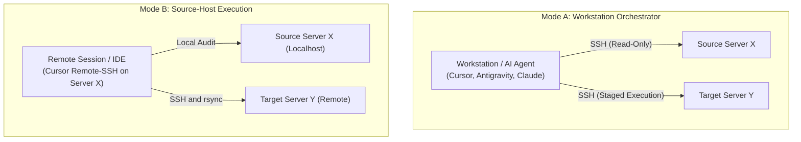
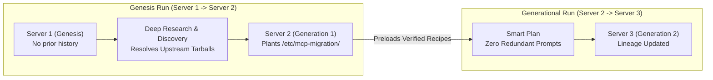

# 🚀 MCP ServerMigrate Agent

[](https://www.python.org/downloads/)
[](https://www.redhat.com/en/technologies/linux-platforms/enterprise-linux)
[](https://modelcontextprotocol.io/)
[](LICENSE)

An intelligent, enterprise-grade **Model Context Protocol (MCP)** agent designed for migrating, modernizing, and auditing **Enterprise Linux** servers (Red Hat Enterprise Linux, Rocky Linux, AlmaLinux, Oracle Linux, CentOS Stream, and Fedora).

Built specifically for **domain-joined, policy-managed environments** (SSSD, Active Directory, Red Hat Satellite, GPO baselines), `mcp-servermigrate` bridges the gap between central compliance baselines and application-level customizations.

---

## 🌟 Key Features

* 🔍 **Phase 1: Deep Discovery & Lineage Detection**
  * Differentiates OS/Satellite-managed RPMs from unmanaged binaries (`terraform`, `gh`, `rclone`, `kubectl`, custom binaries in `/opt` and `/usr/local/bin`).
  * Automatically detects **Genesis vs. Generational Hosts** by inspecting on-server migration records (`/etc/mcp-migration/manifest.json`).
* 📦 **Phase 2: Universal Dynamic Release Resolver**
  * Proactively resolves **latest stable upstream releases** for tools not in Red Hat repositories (HashiCorp, GitHub Releases, vendor endpoints).
  * Automatically handles universal archives (`.tar.gz`, `.zip`, `.tgz`, raw binaries) and stages them into `/opt/tools/bin/`.
* 🛡️ **Phase 3: Decoupled RBAC & Shell Layering**
  * Bridges Active Directory identities to local semantic role groups (`tool_users`, `app_operators`) via PAM (`/etc/security/group.conf`).
  * Applies **POSIX ACLs with default inheritance (`-d`)** so all newly deployed tools inherit execution permissions for domain users.
  * Injects global tool paths non-destructively via `/etc/profile.d/corp-standards.sh` while preserving user customizability in `~/.bashrc`.
* 🧠 **Phase 4: On-Server Migration Skill & Lineage Recording**
  * Plants a persistent machine-readable manifest (`/etc/mcp-migration/manifest.json`) and an operational skill (`/etc/mcp-migration/SKILL.md`) on target hosts.
  * **Generational Inheritance:** Future migrations from Server 2 to Server 3 automatically preload verified recipes, permissions, and URLs learned during previous runs.
* 🔐 **Safe Staged Execution with Ephemeral Credentials**
  * Rotating sudo passwords stay in volatile RAM—never leaked into LLM prompts, disk, or logs.
  * Interactive human-in-the-loop approval gates before elevated mutations (with optional `--auto-approve-sudo` bypass).
* 🩺 **Post-Flight Health Verification**
  * Audits SELinux denial logs (`ausearch -m avc`) and ensures `bin_t` context is enforced.
  * Verifies listening sockets (`ss -tulpn`) and systemd service health.

---

## 🏗️ Architecture & Deployment Topologies



---

## 🧬 Generational Lineage Workflow



---

## 📥 Installation

Clone the repository and set up a virtual environment in your preferred workspace directory:

```bash
# 1. Clone the repository
git clone https://github.com/<your-org>/mcp-servermigrate.git
cd mcp-servermigrate

# 2. Initialize and activate Python virtual environment (Python 3.11+)
python3 -m venv .venv
source .venv/bin/activate

# 3. Install in editable mode
pip install --upgrade pip
pip install -e .
```

---

## 🚀 How to Run (MCP Agent Integration)

`mcp-servermigrate` is designed primarily as an **MCP (Model Context Protocol) Server**, providing your AI agent (Cursor, Antigravity, Claude Desktop, etc.) with direct tools to audit and migrate servers.

Choose the deployment mode that fits your environment:

### Mode A: Local Execution on Your Workstation (Windows / macOS / Linux / WSL)

The MCP server runs on your local machine or jump host. The AI agent connects to both Source and Target servers remotely over SSH, leaving **zero software footprint** on either server.

#### 1. Native Linux / macOS Workstation Configuration
Add this entry to your client's MCP configuration file (e.g., `mcp_config.json` or `.cursor/mcp.json`):

```json
{
  "mcpServers": {
    "server-migrate": {
      "command": "<path-to-repo>/.venv/bin/python",
      "args": ["-m", "mcp_servermigrate.server"]
    }
  }
}
```

#### 2. Windows Host (Bridging into WSL) Configuration
If your AI IDE runs on Windows and the project is hosted inside WSL:

```json
{
  "mcpServers": {
    "server-migrate": {
      "command": "wsl.exe",
      "args": [
        "-d", "<your-wsl-distro-name>",
        "bash", "-c",
        "cd <path-to-repo> && source .venv/bin/activate && python -m mcp_servermigrate.server"
      ]
    }
  }
}
```

---

### Mode B: Local Execution on the Server (Source Server X)

The MCP server runs directly on the source server (Server X)—ideal if you are connecting via **Cursor Remote-SSH** or running an on-box agent session.

#### 1. Cursor Remote-SSH Workspace
When Cursor is connected directly to Server X, add this to the workspace's `.cursor/mcp.json`:

```json
{
  "mcpServers": {
    "server-migrate": {
      "command": "<path-to-repo-on-server>/.venv/bin/python",
      "args": ["-m", "mcp_servermigrate.server"]
    }
  }
}
```

#### 2. Remote SSH Pipe (Local Agent $\rightarrow$ Remote Server)
If your local AI agent wants to execute the MCP server remotely on Server X without opening a full remote IDE session:

```json
{
  "mcpServers": {
    "server-migrate-remote": {
      "command": "ssh",
      "args": [
        "-T",
        "<user>@<source-server-host>",
        "<path-to-repo-on-server>/.venv/bin/python -m mcp_servermigrate.server"
      ]
    }
  }
}
```

---

## 🛠️ Exposed MCP Tools

Once connected, your AI assistant will have access to the following tools:

| Tool Name | Parameters | Description |
| :--- | :--- | :--- |
| `audit_host` | `host`, `user` | Performs a deep audit of a server, checks for `/etc/mcp-migration/manifest.json`, and returns structured JSON telemetry. |
| `create_migration_plan` | `source_host`, `target_host`, `user` | Performs gap analysis, preloads verified recipes from prior lineage if present, resolves upstream releases, and generates an actionable plan. |
| `execute_migration` | `source_host`, `target_host`, `user` | Executes the migration, downloads tarball CLI tools, deploys RBAC and profile baselines, and plants the on-server `SKILL.md` lineage. |

---

## 🧪 Testing

Run the automated test suite on your host:

```bash
source .venv/bin/activate
pytest tests/ -v
```

---

## 📄 License

This project is licensed under the MIT License - see the [LICENSE](LICENSE) file for details.
