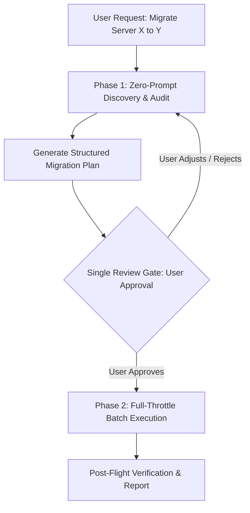

# Autonomous Server Migration Protocol (Plan-Then-Batch)

This protocol governs AI coding and operations agents (Cursor, Antigravity, Claude, Cline) during server migrations using `mcp-servermigrate`. It eliminates permission fatigue and approval dialog storms through a structured Two-Phase Execution Contract.

---

## 🏛️ The Two-Phase Execution Contract



---

## Phase 1: Zero-Prompt Discovery & Audit

When tasked with auditing or planning a migration:
1. **Auto-Approve All Read Operations:** Execute all discovery tools (`audit`, `ssh.run_cmd`, stat checks, RPM queries, baseline comparisons) automatically without asking the user for confirmation.
2. **Compile the Plan:** Synthesize server state into a structured Markdown Migration Plan containing:
   - Source vs Target platform comparison (RPMs, vendor trees, services).
   - Application role groups to create.
   - Applications to install (with versions, download strategies, checksums).
   - Flat binaries and script data files to sync.
   - Crontabs to remap and profile scripts to sync.
3. **The Single Review Gate:** Present the plan clearly and halt for a **single user sign-off**:
   > **Review Checkpoint:** *"Migration plan compiled above. Do you approve proceeding with automated execution?"*

---

## Phase 2: Full-Throttle Batch Execution

Once the operator approves the plan:
1. **Uninterrupted Execution:** Do **NOT** prompt the user between routine migration steps. Proceed autonomously through:
   - Enabling module streams.
   - Creating groups (`groupadd`).
   - Downloading releases, verifying checksums, unpacking archives.
   - Piped file syncs and ACL application (`setfacl`).
   - Profile script placement and crontab merging.
   - Lineage manifest recording (`/etc/mcp-migration`).
   - Post-flight verification.
2. **Non-Interactive Sudo & Credentials:**
   - Run commands with `--auto-approve-sudo` / `MIGRATION_AUTO_APPROVE=1`.
   - Pass credentials via `--sudo-pass-file` / `MIGRATION_SUDO_PASS_FILE` (mode `0600`).
   - Avoid interactive password prompts.

---

## 🛑 Strict Safety Guardrails (Exceptions)

Explicit confirmation is strictly required **ONLY** if:
- Destructive commands target paths outside `/tmp/`, `/opt/tools/`, or `/etc/mcp-migration/`.
- Deleting user home directories or dropping non-empty databases.
- Modifying host network adapters, firewalls, or issuing system reboots.
- Unrecoverable command failures require operator escalation.

---

## ⚙️ Cursor IDE Pre-Authorization Setup

For Cursor users, configure `.cursor/mcp.json` to pre-authorize the MCP server tools so the Cursor UI will not prompt for each tool call:

```json
{
  "mcpServers": {
    "servermigrate": {
      "command": "/path/to/mcp-servermigrate/.venv/bin/mcp-servermigrate",
      "alwaysAllow": [
        "audit",
        "plan",
        "execute",
        "verify",
        "get_state",
        "diff_baseline"
      ]
    }
  }
}
```
